# Despliegue de la Pokédex en Azure

Aplicación **Pokédex** (Angular 14) publicada en **Azure App Service** sobre una suscripción **Azure for Students**, con despliegue continuo desde GitHub y calificación **A+** en securityheaders.com y en SSL Labs.

- **Repositorio:** https://github.com/Jddm018/pokedex
- **Aplicación publicada:** https://app-pokedex-lima-prod-jddm-draecgaghrarb0gj.westus3-01.azurewebsites.net
- **Código fuente de partida:** https://github.com/rcuello/ac4dem1a/tree/master/sistemas-distribuidos/poke-dex-lab (carpeta `pokedex-angular`)

---

## Índice

1. [Arquitectura](#1-arquitectura)
2. [Preparación del código](#2-preparación-del-código)
3. [Creación de la aplicación en Azure](#3-creación-de-la-aplicación-en-azure)
4. [Despliegue continuo (CI/CD)](#4-despliegue-continuo-cicd)
5. [Verificación](#5-verificación)
6. [Problemas encontrados y cómo se resolvieron](#6-problemas-encontrados-y-cómo-se-resolvieron)

---

## 1. Arquitectura

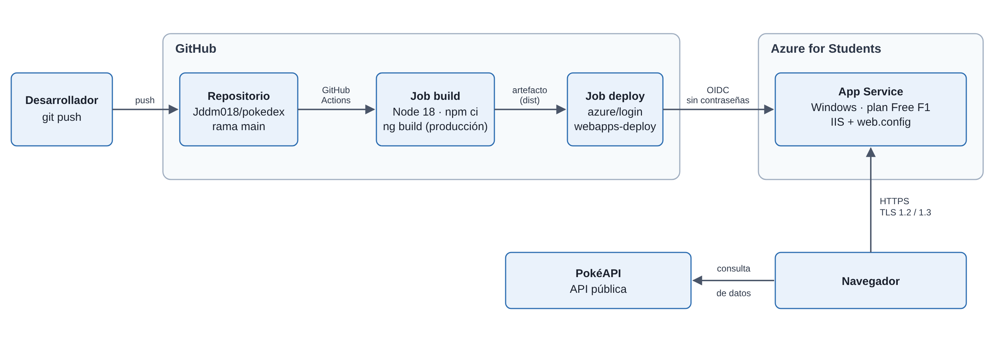

*Figura 1. Arquitectura de la solución.*

La aplicación es **estática** (HTML, CSS y JavaScript compilados). Consume la API pública PokéAPI directamente desde el navegador, por lo que no hay backend propio.

### Recursos creados en Azure

| Recurso | Nombre | Detalle |
|---|---|---|
| Suscripción | Azure for Students | Crédito educativo |
| Grupo de recursos | `rg-pokedex-japan-prod` | Contiene todos los recursos |
| Aplicación web | `app-pokedex-lima-prod-jddm` | App Service, publicación por código |
| Plan de App Service | Plan propio de la aplicación | Windows, **Gratis F1** (1 GB de memoria) |
| Identidad administrada | Asignada por el usuario | Permite el inicio de sesión sin contraseña (OIDC) |
| Región | West US 3 | Única compatible con la política de la suscripción (ver [sección 6](#6-problemas-encontrados-y-cómo-se-resolvieron)) |

### Convención de nombres

Se aplicó la convención de la guía de buenas prácticas del curso, `[Prefijo]-[Proyecto]-[Ubicación]-[Tipo]-[Entorno]`, en su variante orientada a seguridad: los nombres evitan dar información innecesaria sobre la infraestructura. Se añadió un sufijo propio (`jddm`) porque el nombre de la aplicación es único a nivel global. Esto reduce información al reconocimiento, pero **no sustituye** a las medidas reales: cabeceras, TLS y autenticación sin contraseñas.

---

## 2. Preparación del código

### 2.1 Repositorio y commits (comandos)

```powershell
git init
git remote add origin https://github.com/Jddm018/pokedex.git
git config --local user.name  "Jddm018"
git config --local user.email "<correo asociado a la cuenta de GitHub>"
git add .
git commit -m "feat: despliegue inicial de Pokedex con encabezados de seguridad"
git push -u origin main
```

### 2.2 Cambios al código y por qué

El proyecto original estaba pensado para **GitHub Pages**, que publica bajo un subdirectorio (`/pokedex-angular/`). Azure publica en la raíz, y además la política de seguridad (CSP) prohíbe scripts en línea.

Al inicio se planeó desplegar en **Azure Static Web Apps**, por lo que las cabeceras de seguridad se escribieron primero en un archivo `staticwebapp.config.json`. Ese servicio no se pudo usar en la suscripción (ver [problema 1](#problema-1-la-política-de-la-suscripción-impidió-usar-static-web-apps)) y se cambió a App Service, donde `web.config` reemplazó esa configuración. Por eso aparece en la tabla como archivo creado y luego retirado.

| Archivo | Cambio | Motivo |
|---|---|---|
| `src/environments/environment.prod.ts` | `imagesPath` de `/pokedex-angular/assets/images` a `/assets/images` | En Azure la raíz es `/`; con la ruta vieja los sprites daban 404 |
| `src/index.html` | Se eliminó el `<script>` en línea de "Single Page Apps for GitHub Pages" | La CSP `script-src 'self'` bloquea scripts en línea |
| `src/404.html` | Eliminado | Truco de GitHub Pages para rutas de una SPA; aquí lo resuelve IIS |
| `angular.json` | `inlineCritical: false` y se agregó `src/web.config` a `assets` | Angular inserta CSS crítico con un `onload` en línea que la CSP bloquea; y el `web.config` debe copiarse a `dist` |
| `.github/workflows/pipelines.yml` | Eliminado | Pipeline heredado (pruebas y Codecov) que no aplica a este despliegue |
| `src/staticwebapp.config.json` | Creado al inicio y eliminado después | Era la configuración del plan inicial (Static Web Apps). Solo sirve en ese servicio, así que dejó de aplicar al cambiar a App Service |
| `src/web.config` | Creado | Sustituye al archivo anterior en IIS: cabeceras de seguridad, tipos MIME y reescritura de rutas |

### 2.3 El archivo `web.config`

IIS lee este archivo para configurar el sitio. Hace tres cosas:

1. **Cabeceras de seguridad** (`customHeaders`), y quita `X-Powered-By` para no anunciar la tecnología.
2. **Tipos MIME** de las fuentes (`.ttf`, `.woff`, `.woff2`), que IIS no sirve por defecto.
3. **Reescritura de rutas** (URL Rewrite): si la ruta no es un archivo ni una carpeta, devuelve `index.html`. Sin esto, entrar directo a `/pokemon/1` o refrescar con F5 daría 404, porque esa ruta solo existe dentro de Angular.

| Cabecera | Valor | Protege contra |
|---|---|---|
| `Content-Security-Policy` | Solo recursos propios y los orígenes externos estrictamente necesarios (fuentes, imágenes y la API pública); sin objetos incrustados ni marcos; fuerza HTTPS en los recursos | XSS e inyección de contenido externo |
| `Strict-Transport-Security` | `max-age=31536000; includeSubDomains` | Obliga a usar HTTPS durante un año (evita *downgrade*) |
| `X-Frame-Options` | `DENY` | *Clickjacking* (que otro sitio incruste la página) |
| `X-Content-Type-Options` | `nosniff` | Que el navegador adivine tipos de archivo |
| `Referrer-Policy` | `strict-origin-when-cross-origin` | Filtración de URLs completas a otros sitios |
| `Permissions-Policy` | Cámara, micrófono, geolocalización, pagos, USB y sensores desactivados | Uso de funciones del dispositivo que la app no necesita |
| `Cross-Origin-Opener-Policy` | `same-origin` | Aislamiento entre ventanas (ataques tipo Spectre) |
| `Cross-Origin-Resource-Policy` | `same-origin` | Que otros sitios carguen nuestros recursos |

> [!NOTE]
> **Scripts y estilos:** los scripts se limitan a recursos propios, que es lo crítico frente a XSS. Los estilos requieren permitir estilos en línea por la forma en que Angular aplica los de sus componentes.

> [!NOTE]
> **COEP:** no se activó `Cross-Origin-Embedder-Policy` porque exigiría que `assets.pokemon.com` enviara sus propias cabeceras CORP, y las imágenes dejarían de cargar. securityheaders.com lo lista como "Upcoming Headers" (no puntúa).

---

## 3. Creación de la aplicación en Azure

1. En el portal de Azure se busca **App Services**.

   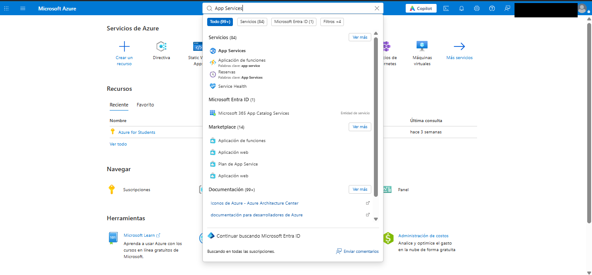

   *Figura 2. Buscar App Services.*


2. **Crear → Aplicación web**.

   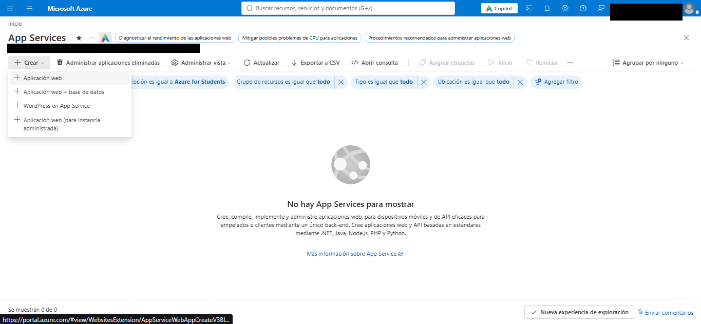

   *Figura 3. Menú Crear.*

3. **Datos básicos:** suscripción Azure for Students; grupo de recursos `rg-pokedex-japan-prod`; nombre `app-pokedex-lima-prod-jddm`; publicar **Código**; **Sistema operativo: Windows**; región **West US 3**.

   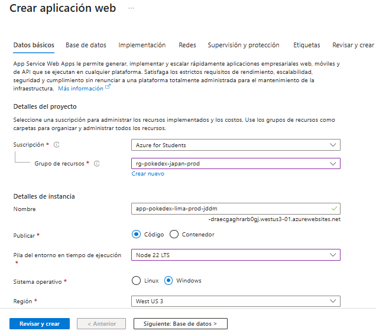

   *Figura 4. Datos básicos.*

   > **Por qué Windows:** el asistente propone Linux por defecto. En Linux, App Service **ignora el `web.config`** y se perderían las cabeceras de seguridad. Con Windows, IIS lo lee.
   >
   > **Pila Node 22:** la aplicación es estática, así que la pila de ejecución no interviene; IIS solo sirve archivos. La compilación ocurre en GitHub Actions.

4. **Plan de precios: Gratis F1.** Suficiente para una aplicación estática de demostración y no consume el crédito de estudiante.

   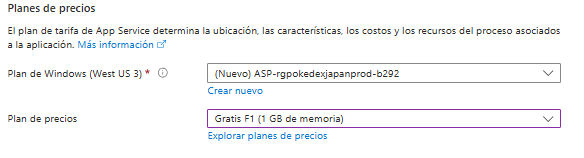

   *Figura 5. Plan Gratis F1.*

5. **Revisar y crear.** La autenticación básica queda **deshabilitada** (por seguridad; el despliegue se hará con OIDC, [sección 4](#4-despliegue-continuo-cicd)).

   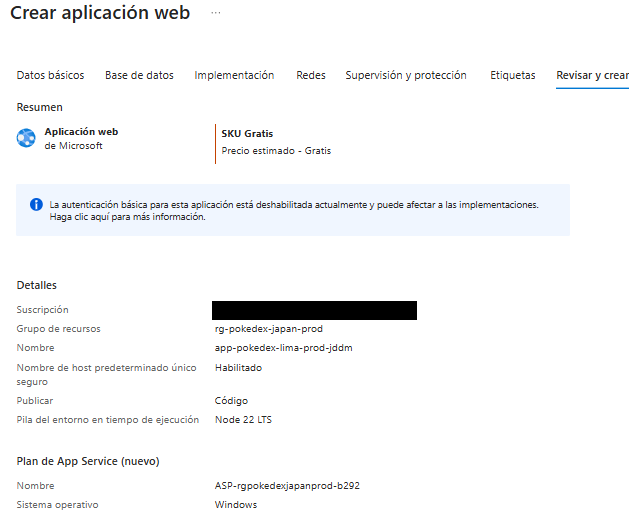

   *Figura 6. Revisar y crear.*

6. Se completa la implementación y la aplicación queda **En ejecución**.

   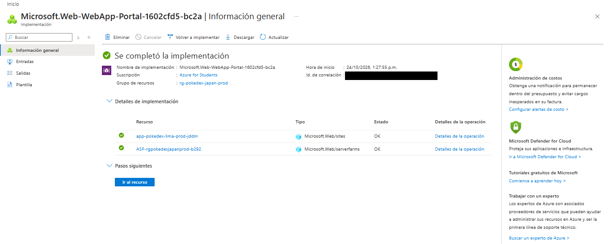

   *Figura 7. Implementación completada.*

   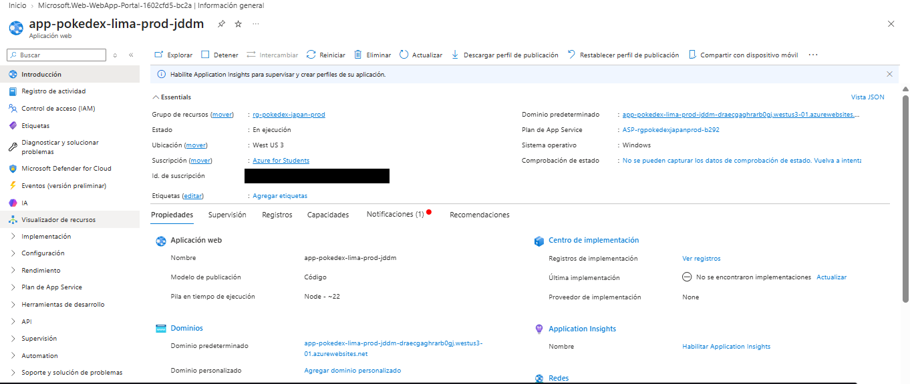

   *Figura 8. Introducción de la Web App.*

---

## 4. Despliegue continuo (CI/CD)

En la Web App: **Centro de implementación → Implementación continua (CI/CD)**, origen **GitHub**.

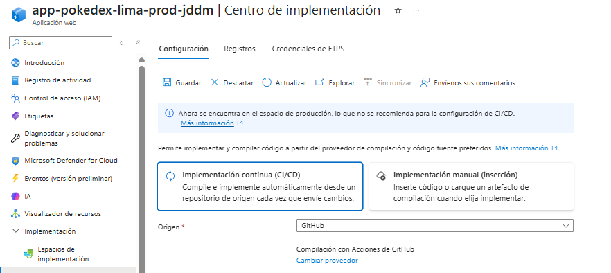

*Figura 9. Centro de implementación.*

Se eligió la cuenta `Jddm018`, repositorio `pokedex`, rama `main`, y **agregar un flujo de trabajo** nuevo.

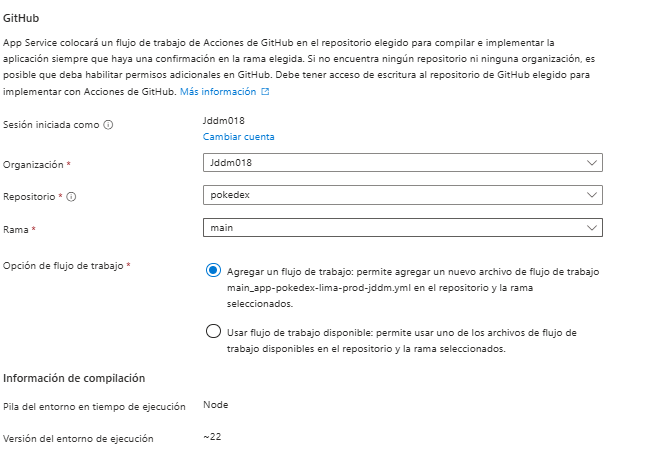

*Figura 10. Organización, repositorio y rama.*

**Autenticación: identidad asignada por el usuario (OIDC)** en lugar de "autenticación básica".

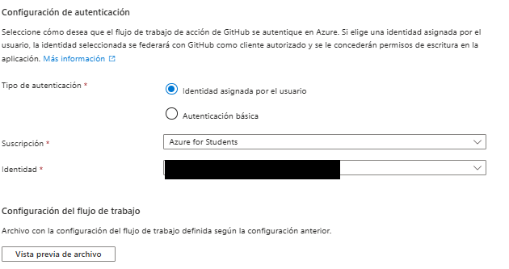

*Figura 11. Autenticación OIDC.*

| | OIDC (elegido) | Perfil de publicación / autenticación básica |
|---|---|---|
| Credencial | Token temporal que GitHub pide en cada ejecución | Usuario y contraseña de larga duración |
| Si se filtra | No hay nada permanente que robar | Hay que rotarla |
| Almacenamiento | Solo IDs en los secretos del repositorio | La contraseña queda en los secretos |

Azure creó el archivo `.github/workflows/main_app-pokedex-lima-prod-jddm.yml` mediante un commit en el repositorio. Fue necesario ejecutar `git pull` para traerlo al equipo local antes de seguir trabajando.

### 4.1 Flujo de trabajo final

El archivo generado por Azure se corrigió (ver [problemas en la sección 6](#6-problemas-encontrados-y-cómo-se-resolvieron)). La versión final está en el repositorio: [`.github/workflows/main_app-pokedex-lima-prod-jddm.yml`](.github/workflows/main_app-pokedex-lima-prod-jddm.yml). Tiene dos trabajos, `build` y `deploy`; este es el criterio de cada decisión:

| Elemento | Qué hace y por qué | Cambio respecto al archivo generado por Azure |
|---|---|---|
| `on: push` a `main` | Cada push a `main` despliega: eso es el CI/CD | Sin cambios |
| `workflow_dispatch` | Permite ejecutarlo a mano desde la pestaña Actions | Sin cambios |
| `runs-on: ubuntu-latest` (build) | La compilación de una app estática no depende del sistema operativo y Linux arranca más rápido. La app se **sirve** desde Windows (IIS), pero se **compila** en Linux | Antes `windows-latest` |
| Node `18.x` | Angular 14 soporta oficialmente Node 14 y 16; Node 18 es la versión estable más cercana | Antes `22.x`, demasiado nuevo para esta versión de Angular |
| `npm ci` | Instala exactamente lo del `package-lock.json`: compilación reproducible | Antes `npm install` |
| `HUSKY: 0` | Desactiva los *git hooks* locales (`husky install` corre al instalar y no tiene sentido en CI) | Nuevo |
| `npm run build` | Compila la aplicación en modo producción | Antes `npm run build --if-present`, que ignoraba el fallo si el script no existía |
| Paso de pruebas | No se ejecutan pruebas en el *pipeline* | **Eliminado** `npm run test`; ver [problema 3](#problema-3-el-flujo-de-trabajo-generado-por-azure-no-era-adecuado) |
| `path: dist/pokedex-angular` | Se publica **solo la aplicación compilada** (incluye `index.html` y `web.config`), no el código fuente ni `node_modules` | Antes `path: .` (todo el repositorio) |
| `needs: build` | `deploy` solo se ejecuta si `build` terminó bien | Sin cambios |
| `id-token: write` + `azure/login` | Permiten el inicio de sesión sin contraseña por OIDC | Sin cambios |
| `package: .` (deploy) | Despliega lo descargado del artefacto | Sin cambios en la línea, pero ahora `.` contiene solo la app compilada |

### 4.2 Resultado

Ejecución correcta (**2 min 1 s**: build 1 min 25 s, deploy 29 s):

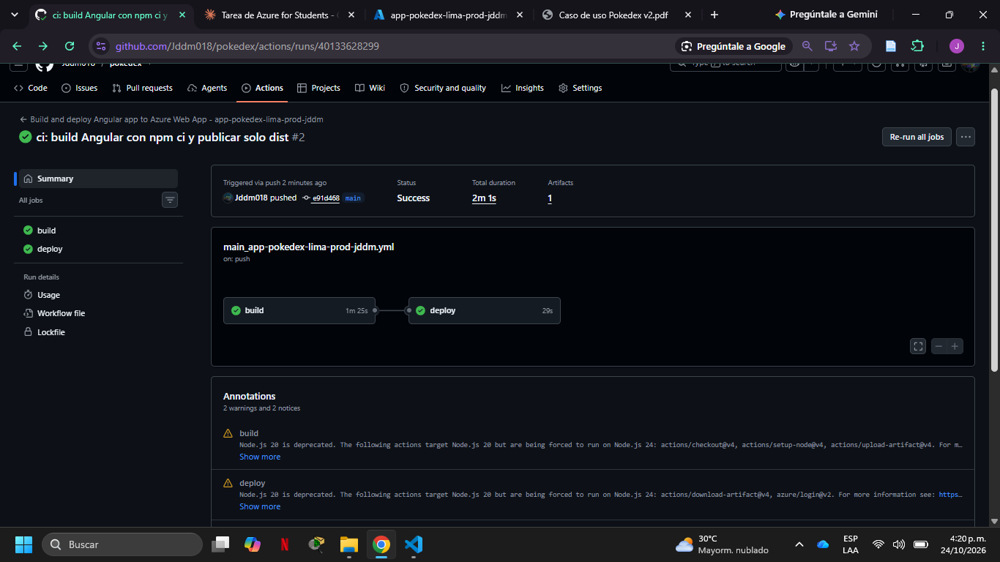

*Figura 12. Actions: ejecución correcta.*

Registro de despliegues en Azure:

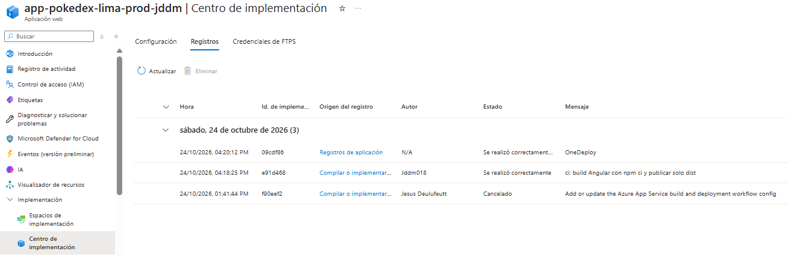

*Figura 13. Registros del Centro de implementación.*

---

## 5. Verificación

### 5.1 Funcionamiento

La aplicación carga con estilos e imágenes, y las rutas internas funcionan al abrirlas directamente (la regla de reescritura de IIS funciona):

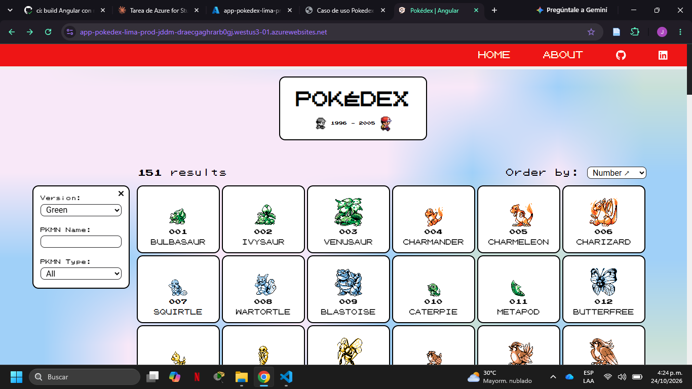

*Figura 14. Página principal.*

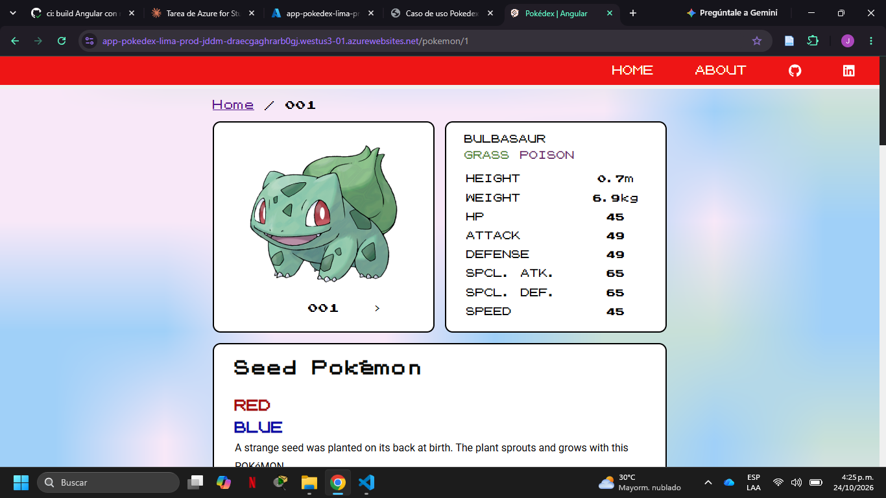

*Figura 15. Ruta directa /pokemon/1.*

### 5.2 Cabeceras recibidas (navegador, F12 → Network)

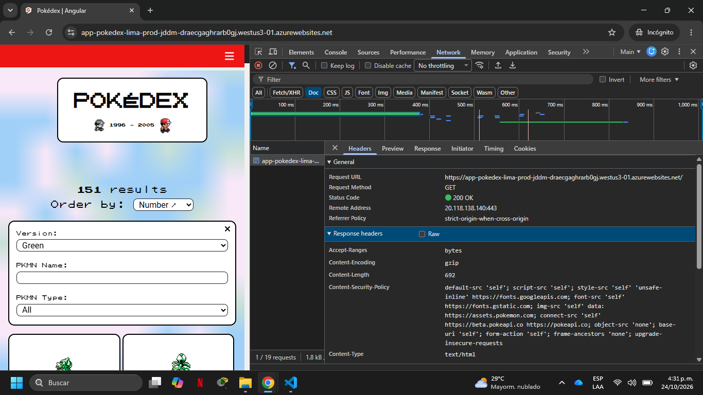

*Figura 16. Cabeceras de respuesta (1/2).*

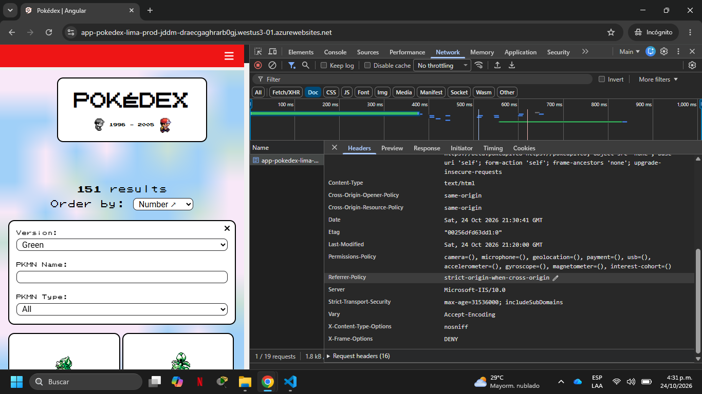

*Figura 17. Cabeceras de respuesta (2/2).*

### 5.3 securityheaders.com: **A+**

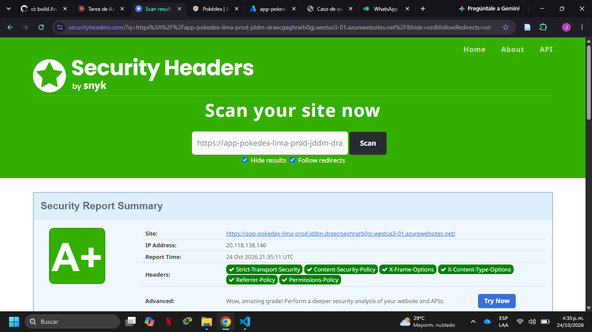

*Figura 18. Resultado securityheaders.com.*

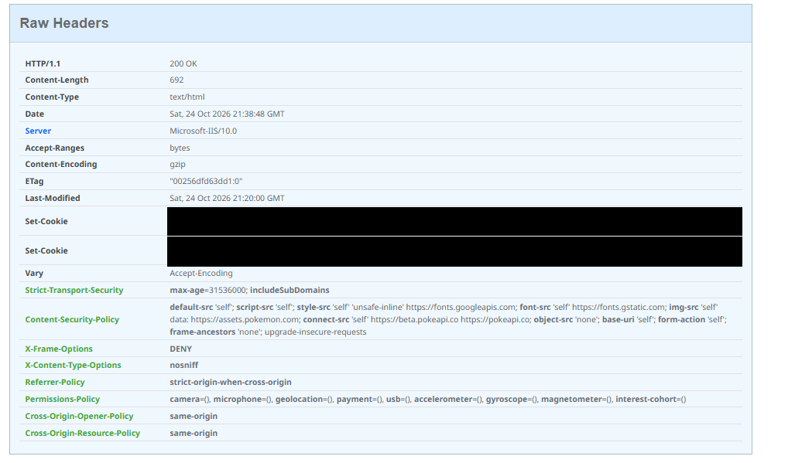

*Figura 19. Cabeceras en bruto.*

`Cross-Origin-Embedder-Policy` aparece como "Upcoming" y no puntúa; ver la nota de COEP en la [sección 2.3](#23-el-archivo-webconfig).

### 5.4 Endurecimiento de la configuración en Azure

**Configuración → Configuración general**:

| Ajuste | Valor | Efecto |
|---|---|---|
| HTTPS solamente | Activado | Redirige `http://` a `https://` |
| Versión mínima de TLS entrante | 1.2 | Rechaza TLS 1.0 y 1.1 |
| Versión mínima de TLS de SCM | 1.2 | Lo mismo para el sitio de administración |
| Credenciales de autenticación básica (SCM y FTP) | Desactivadas | Sin despliegue con usuario y contraseña |
| Estado FTP | Solo FTPS | Si se usa FTP, va cifrado |
| Depuración remota | Desactivada | Sin puerta de depuración en producción |

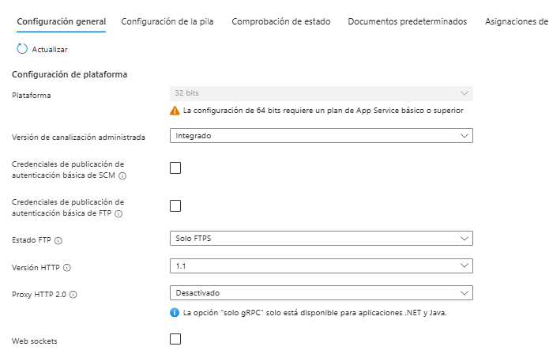

*Figura 20. Configuración general (1/2).*

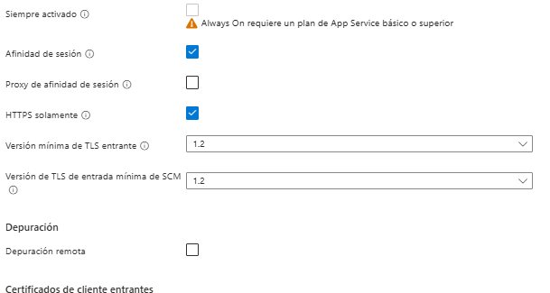

*Figura 21. Configuración general (2/2).*

### 5.5 SSL Labs: **A+** (punto extra)

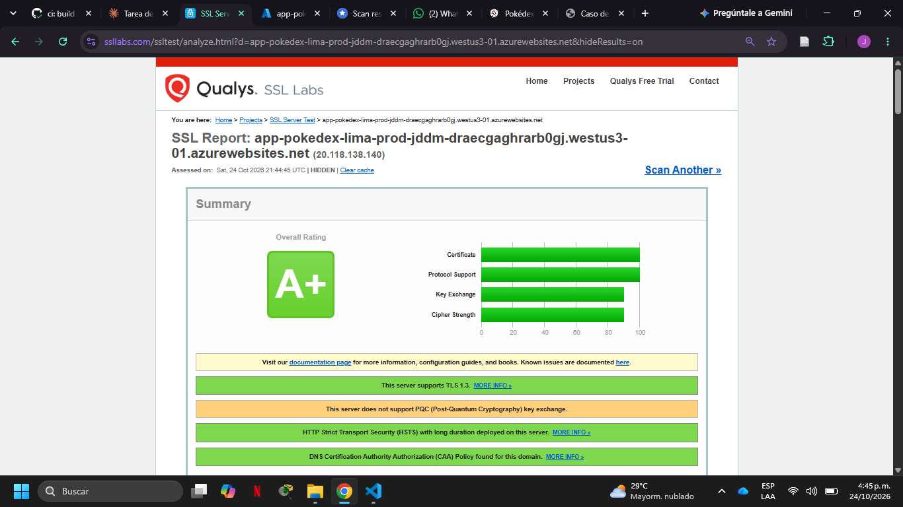

*Figura 22. Resultado SSL Labs.*

Soporta **TLS 1.3**, tiene **HSTS** de larga duración y política **CAA** en el dominio. La única advertencia (sin intercambio de claves poscuántico) depende de la plataforma de Azure, no de la configuración de la aplicación.

### Resumen de resultados

| Verificación | Resultado |
|---|---|
| Despliegue en Azure | Correcto |
| securityheaders.com | **A+** |
| SSL Labs | **A+** |
| Cabeceras de seguridad | 8 de 8 presentes |

---

## 6. Problemas encontrados y cómo se resolvieron

### Problema 1: la política de la suscripción impidió usar Static Web Apps

El primer intento fue **Azure Static Web Apps**, el servicio que usan los laboratorios del curso. La creación falló con el error `RequestDisallowedByAzure`: *"This policy maintains a set of best available regions where your subscription can deploy resources"*.

**Diagnóstico:** en **Directiva → Cumplimiento** apareció la política **"Allowed resource deployment regions"**, asignada a la suscripción Azure for Students. Solo permite desplegar en `westus3`, `chilecentral`, `brazilsouth`, `mexicocentral` y `southcentralus`. Static Web Apps solo ofrece Central US, East US 2, West US 2, West Europe y East Asia, así que **no hay ninguna región en común**.

**Decisión:** pasar a **Azure App Service (Web App)**, que sí está disponible en West US 3. Es un servicio PaaS igual de adecuado para contenido estático. Consecuencias: `staticwebapp.config.json` se reemplazó por `web.config` (IIS) y se eligió Windows.

> [!TIP]
> Antes de elegir un servicio conviene revisar las directivas de la suscripción (regiones permitidas) y comprobar que el servicio esté disponible en ellas.

### Problema 2: el asistente proponía Linux

En Linux, el `web.config` se ignora. Se cambió a **Windows** al crear la aplicación ([sección 3](#3-creación-de-la-aplicación-en-azure), paso 3).

### Problema 3: el flujo de trabajo generado por Azure no era adecuado

El archivo que creó Azure tenía tres defectos para este proyecto:

1. **Ejecutaba `npm run test`**, que lanza Karma con Chrome en modo de observación y **no termina nunca** en un servidor. La ejecución se canceló manualmente tras **43 min 55 s**:

   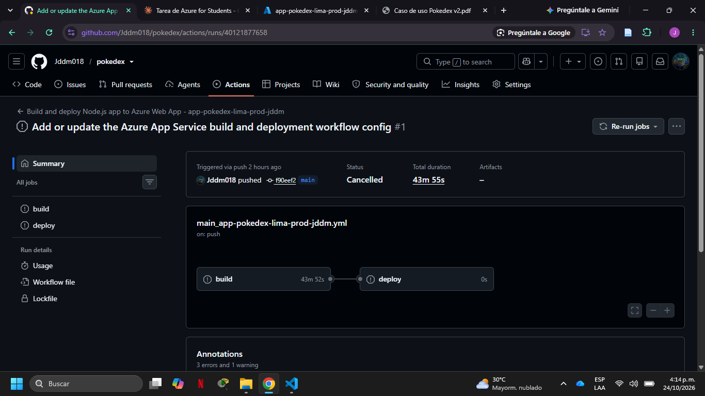

   *Figura 23. Ejecución cancelada.*

2. **Publicaba la carpeta raíz del repositorio** (`path: .`), es decir, código fuente y `node_modules`, en lugar de la aplicación compilada.
3. **Usaba Node 22**, demasiado nuevo para Angular 14.
