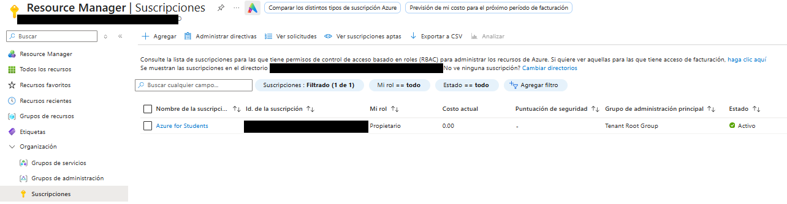
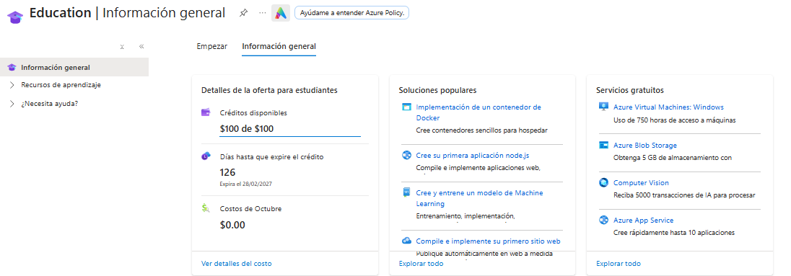

# Creación de la cuenta de Azure for Students

Tutorial paso a paso de cómo se creó la cuenta en la nube (Azure for Students) usada para desplegar la Pokédex.

## Paso 1. Entrar a la página de Azure for Students

Se abre la página de la oferta para estudiantes de Microsoft Azure: https://azure.microsoft.com/pricing/purchase-options/azure-account

## Paso 2. Iniciar sesión con el correo institucional

Se inicia sesión con la cuenta de correo **institucional** de la universidad. Con este correo se comprueba que la persona es estudiante.

## Paso 3. Verificar la condición de estudiante

Microsoft envía un **código de verificación al correo institucional**. Se abre el correo, se copia el código y se escribe en la página de verificación.

## Paso 4. Aceptar las condiciones de la oferta

Una vez verificado el correo, se aceptan las condiciones de la oferta. No se solicita tarjeta de crédito.

## Paso 5. Entrar al portal de Azure

Se ingresa al portal: https://portal.azure.com. Azure crea automáticamente la suscripción **Azure for Students**.

## Paso 6. Comprobar que la suscripción está activa

En **Suscripciones** aparece **Azure for Students** con estado **Activo**, rol **Propietario** y costo actual de 0.00:

*Figura 1. Suscripción Azure for Students activa (estado actual).*

## Paso 7. Comprobar el crédito disponible

En el panel **Education** se ve el crédito de estudiante: 100 de 100 USD disponibles, con su fecha de vencimiento y los costos del mes:

*Figura 2. Crédito disponible de la oferta para estudiantes (estado actual).*

---

El despliegue de la aplicación en esta suscripción se documenta en [Despliegue.md](Despliegue.md).
